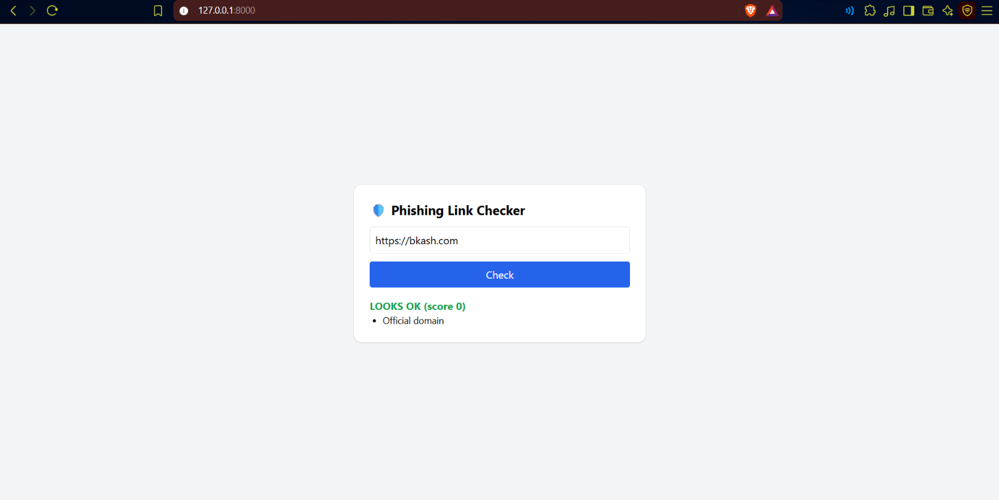
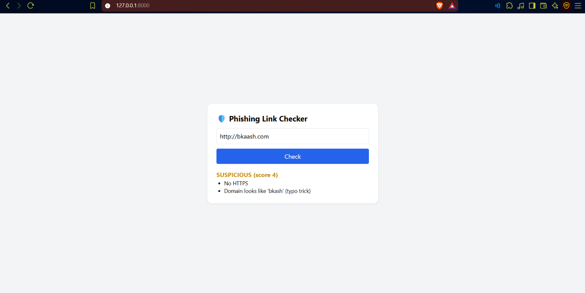
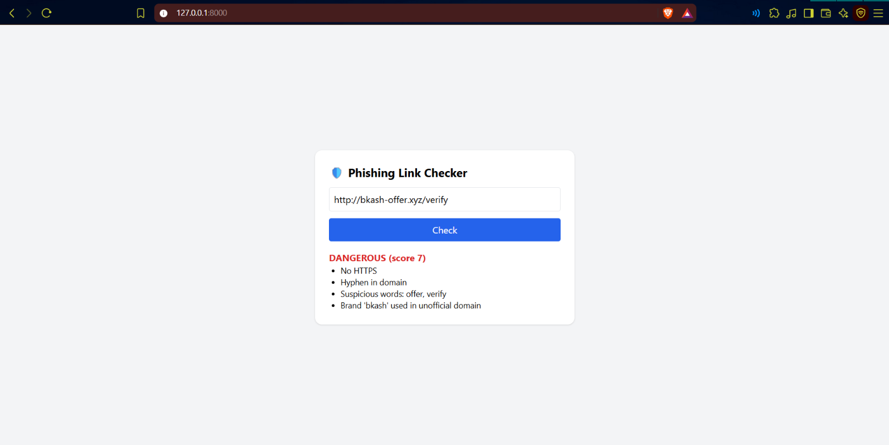
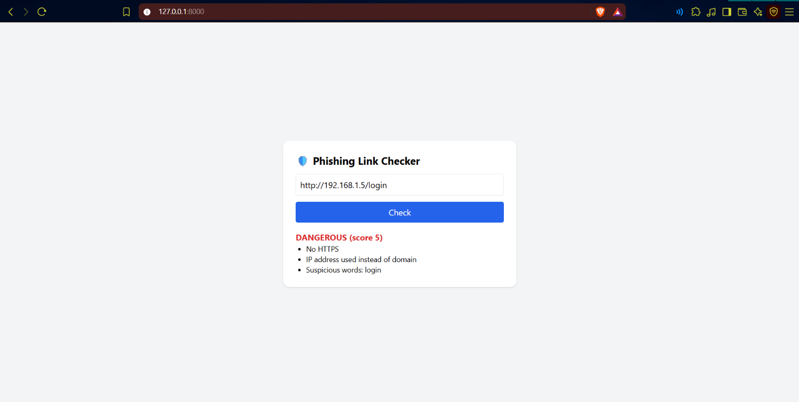

# 🛡️ BD Phishing Link Checker

A simple tool that checks if a link looks like a phishing link.
Made for Bangladeshi mobile banking brands (bKash, Nagad, Rocket, Upay).

## Problem
Fake links pretending to be bKash or Nagad are often sent by SMS and Facebook.
People click them and lose money.

## What it checks
- Fake brand names in unofficial domains (e.g. `bkash-offer.xyz`)
- Typo tricks (e.g. `bkaash.com`)
- IP address used instead of a domain
- `@` symbol in the link
- Too many subdomains
- Hyphens in the domain
- Suspicious words (offer, bonus, verify, login, prize...)
- No HTTPS

## Result
Each link gets a score and a verdict: `LOOKS OK`, `SUSPICIOUS` or `DANGEROUS`,
with the reasons listed.

## Tech
Python, FastAPI, tldextract, rapidfuzz, HTML, Tailwind CSS

## Screenshot

| Looks OK | Suspicious |
| --- | --- |
|  |  |

| Dangerous: suspicious offer link | Dangerous: IP address and login link |
| --- | --- |
|  |  |

## Run it
```bash
pip install -r requirements.txt
python -m uvicorn main:app --reload
```
Open `http://127.0.0.1:8000`

## Limitations
- Rule-based only. It is not AI and it is not 100% accurate.
- The official domain list is small and needs to be updated.
- A "LOOKS OK" result does not guarantee a link is safe.

## Future work
- Add more Bangladeshi brands and banks
- Check domain age
- Browser extension